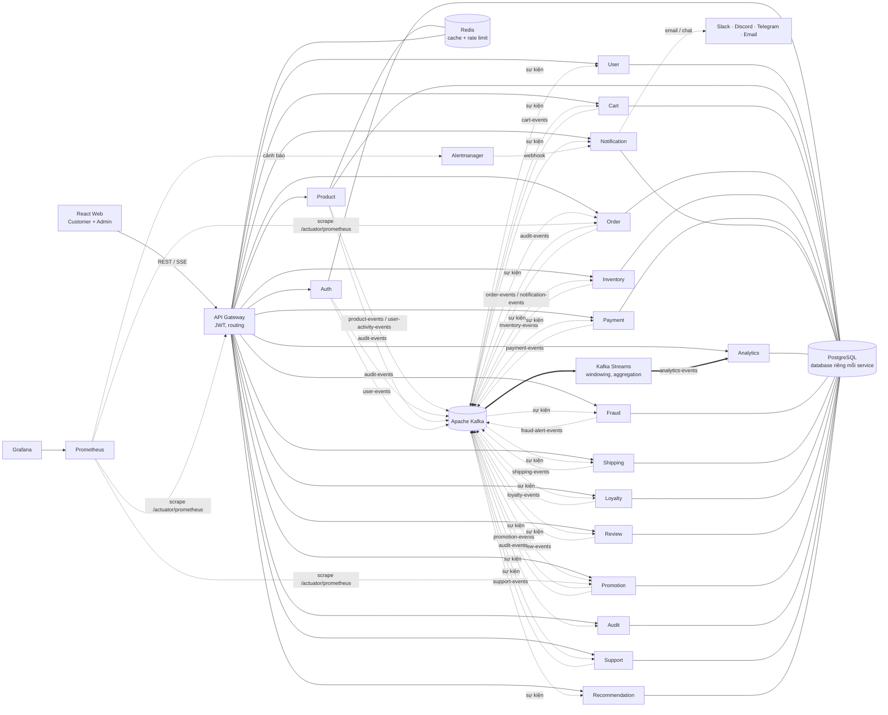

# Real-time E-commerce Analytics Platform

Nền tảng thương mại điện tử theo kiến trúc **Microservices + Event-driven**, dùng **Apache Kafka** để truyền sự kiện giữa các dịch vụ và **Kafka Streams** để tổng hợp, phân tích dữ liệu gần thời gian thực trên Dashboard.

**Phiên bản 2.0** bổ sung: Fraud Detection (chấm điểm rủi ro + xác minh thủ công), Shipping, Loyalty (điểm, hạng, giới thiệu), Review (đánh giá + hỏi đáp), theo dõi hành vi người dùng và truy vết correlationId xuyên suốt.

**Phiên bản 2.1** bổ sung: Promotion (flash sale có giới hạn suất và giới hạn mỗi tài khoản, mã giảm giá, đổi điểm thưởng lấy voucher – định giá trong Saga), bảo mật (rate limit ở Gateway, tạm khóa tài khoản khi dò mật khẩu, nhật ký kiểm toán + cảnh báo bảo mật) và vận hành (Prometheus + Grafana, luật cảnh báo).

**Phiên bản 2.2** bổ sung: Hỗ trợ khách hàng (yêu cầu hỗ trợ gắn với đơn hàng, chat realtime giữa khách và CSKH qua SSE, SLA phản hồi, đánh giá hài lòng) và cảnh báo qua email/chat (Alertmanager → thông báo trong ứng dụng, Slack, Discord, Telegram, email; hộp thư Mailpit cho môi trường demo).

**Phiên bản 2.3** bổ sung: Gợi ý sản phẩm (AI Recommendation – "Dành cho bạn", "Sản phẩm tương tự", "Thường được mua cùng", gợi ý trong giỏ, thịnh hành; học trực tuyến từ luồng sự kiện, mỗi gợi ý kèm lý do, đo CTR và đơn hàng phát sinh từ gợi ý) và Dashboard khởi động nhanh (khôi phục từ snapshot thay vì đọc lại toàn bộ topic).

**Công nghệ:** Java 21 · Spring Boot 3.5 · Spring Cloud Gateway · Apache Kafka 3.9 (KRaft) · Kafka Streams · PostgreSQL 16 · Redis 7 · React 18 + TypeScript · Apache ECharts · SSE · Docker Compose · JUnit 5 / Embedded Kafka / Testcontainers / k6



## 1. Chạy toàn bộ hệ thống (Docker Compose)

Yêu cầu: Docker Desktop (khuyến nghị cấp ≥ 10 GB RAM cho Docker – bản 2.2 chạy 18 JVM + Prometheus, Grafana, Alertmanager, Mailpit, dùng khoảng 8 GB).

```bash
cp .env.example .env          # tùy chọn: chỉnh cấu hình
docker compose up -d --build  # lần đầu build mất vài phút (Maven + npm)
docker compose ps             # chờ các service ở trạng thái running
```

| Thành phần | URL |
|---|---|
| Website khách hàng + trang quản trị | http://localhost:3000 |
| API Gateway | http://localhost:8080 |
| Kafka UI (topic, partition, message, consumer group) | http://localhost:8090 |
| Kafka (từ máy host) | `localhost:9094` |
| PostgreSQL | `localhost:5433` (shop / shop) – đổi bằng `POSTGRES_HOST_PORT` |
| Grafana (dashboard giám sát 17 service) | http://localhost:3001 (admin / `GRAFANA_PASSWORD`, mặc định `admin`) |
| Prometheus (metric, cảnh báo) | http://localhost:9090 – chỉ mở trên localhost |
| Alertmanager (gom nhóm / chống lặp cảnh báo) | http://localhost:9093 – chỉ mở trên localhost |
| Mailpit (hộp thư nhận email cảnh báo, không gửi ra ngoài) | http://localhost:8025 – chỉ mở trên localhost |

> Mỗi lần `up`/khởi động lại, các service Java cần 1–5 phút để cùng lên (17 JVM khởi động song song). Trong lúc đó Gateway trả **503 "Dịch vụ đang khởi động…"** cho service chưa sẵn sàng — không phải lỗi dữ liệu, chỉ cần đợi. Theo dõi bằng `docker compose logs -f product-service auth-service` (dòng `Started …Application`) hoặc trên Grafana ô "Service đang chạy" = 17.

Khi khởi động lần đầu, dữ liệu mẫu được tạo tự động: 5 danh mục, 21 sản phẩm (kèm tồn kho phát qua sự kiện `ProductCreated`) và các tài khoản:

| Vai trò | Email | Mật khẩu |
|---|---|---|
| Admin | `admin@shop.local` | `Admin@123` |
| Product Manager | `pm@shop.local` | `Manager@123` |
| Warehouse Manager | `warehouse@shop.local` | `Manager@123` |
| Analyst | `analyst@shop.local` | `Analyst@123` |
| Nhân viên CSKH | `support@shop.local` | `Support@123` |
| Customer | `customer@shop.local`, `customer1..50@shop.local` | `Customer@123` |

Dừng hệ thống: `docker compose down` (thêm `-v` để xóa dữ liệu).

Nâng cấp từ bản trước: chỉ cần `docker compose up -d --build` — không phải xóa volume. Service `db-init` tạo thêm `fraud_db`, `loyalty_db`, `shipping_db`, `review_db`; Hibernate thêm các cột mới (cho phép NULL); các service mới đọc lại lịch sử topic để dựng read-model (Loyalty tự tích điểm cho đơn cũ, không gửi thông báo cho sự kiện cũ).

## 2. Thử luồng đặt hàng xuyên dịch vụ

1. Đăng nhập `customer@shop.local` → thêm sản phẩm vào giỏ → **Đặt hàng**.
2. Trang chi tiết đơn hiển thị trạng thái chạy qua Saga: `PENDING → AWAITING_PAYMENT → CONFIRMED` (giữ hàng và chấm điểm rủi ro chạy song song), sau đó vận đơn `Chờ đóng gói → … → Đã giao` từ Shipping Service; chuông thông báo nhận cập nhật realtime (SSE).
3. Đặt lại với phương thức **"Thẻ bị từ chối (kiểm thử)"** → đơn chuyển `CANCELLED`, kho được hoàn lại (hành động bù).
4. Mở tab ẩn danh, đăng nhập `admin@shop.local` → **Dashboard** cập nhật doanh thu, số đơn, trạng thái, top sản phẩm, cảnh báo, consumer lag Kafka mỗi giây.
5. Mở Kafka UI để xem các message trên `order-events`, `inventory-events`, `fraud-alert-events`, `payment-events`, `shipping-events`, `analytics-events`... — mọi message của cùng một lần đặt hàng mang chung header `correlationId` (bằng header `X-Correlation-Id` của response).
6. **Ecommerce 2.0**: đơn ≥ 100 triệu từ tài khoản mới → **Đang xác minh** → `analyst@shop.local` xử lý ở *Rủi ro & gian lận*; `warehouse@shop.local` xử lý vận đơn ở *Vận chuyển*; khách xem điểm/hạng/mã giới thiệu ở *Thành viên* và đánh giá sản phẩm sau khi nhận hàng. Chi tiết: kịch bản D–G trong [docs/TESTING.md](docs/TESTING.md).
7. **Ecommerce 2.1**: trang **🔥 Khuyến mãi** có flash sale đang chạy và mã `WELCOME10` / `FREESHIP` / `GIAM50K`; nhập mã ở bước thanh toán (báo giá trực tiếp, cảnh báo khi vượt giới hạn flash sale); đổi điểm lấy voucher ở *Thành viên*. Quản trị: *🎁 Khuyến mãi* (tạo flash sale / mã, thống kê), *🔐 Nhật ký kiểm toán* (ADMIN), *📡 Giám sát (Grafana)*. Kịch bản H–K trong [docs/TESTING.md](docs/TESTING.md).
8. **Ecommerce 2.2**: khách mở **Hỗ trợ** (hoặc nút "Cần hỗ trợ về đơn này?" ở trang đơn hàng) để chat với CSKH; `support@shop.local` trả lời ở *🎧 Hỗ trợ khách hàng* – tin nhắn hiện ngay hai phía. ADMIN xem *🚨 Cảnh báo hệ thống* (gửi thử, lịch sử, kênh đang bật); email cảnh báo xem tại Mailpit http://localhost:8025. Kịch bản L–M trong [docs/TESTING.md](docs/TESTING.md).
9. **Ecommerce 2.3**: trang chủ có khối *✨ Dành cho bạn* (khách vãng lai: *🔥 Đang thịnh hành*), trang sản phẩm có *🛍️ Thường được mua cùng* và *Sản phẩm tương tự*, giỏ hàng có *Có thể bạn cũng cần* – mỗi món kèm lý do gợi ý. ADMIN/ANALYST xem CTR, đơn hàng nhờ gợi ý và hồ sơ sở thích của khách ở *🧠 Gợi ý sản phẩm*. Kịch bản N–O trong [docs/TESTING.md](docs/TESTING.md).

### Khách hàng ảo (chạy sẵn khi `docker compose up`)

`simulator-service` liên tục tạo khách hàng ảo truy cập qua API Gateway như người thật: xem/tìm kiếm sản phẩm, thêm giỏ, bỏ giỏ, đặt hàng bằng thẻ/ví, thỉnh thoảng bị từ chối thẻ hoặc hủy đơn, đăng ký tài khoản mới. Mỗi khách có "tính cách" (tiết kiệm / bình thường / chịu chi), và một vài sản phẩm "hot" được mua nhiều hơn hẳn. Khách quay lại **đánh giá / hỏi đáp** sản phẩm đã nhận, thỉnh thoảng có **"khách đáng ngờ"** (tài khoản mới đặt đơn rất lớn) để Fraud Service gắn cờ. Song song có **nhân viên kho ảo** (tự nhập hàng khi sắp hết), **nhân viên vận chuyển ảo** (xử lý vận đơn: đóng gói → bàn giao → đang giao → đã giao) và **nhân viên xác minh ảo** (duyệt đơn bị gắn cờ sau ~45 giây), nên hệ thống chạy được nhiều giờ liền mà không cạn hàng.

Điều khiển tại **http://localhost:3000/admin/simulator** (đăng nhập ADMIN): bật/tắt, chỉnh số lượt/phút, tỷ lệ bỏ giỏ / thẻ lỗi / hủy đơn, lưu lượng dao động theo giờ cao điểm, và nút **Mua dồn dập** để kích hoạt cảnh báo đột biến. Tắt tự chạy bằng `SIMULATOR_AUTOSTART=false` trong `.env`.

Tạo lưu lượng lớn cho Dashboard bằng k6 (≥ 10.000 sự kiện):

```bash
docker compose --profile loadtest run --rm k6 run /scripts/simulate-traffic.js
docker compose --profile loadtest run --rm k6 run -e BUYERS=200 /scripts/flash-sale.js
```

Chi tiết 3 kịch bản demo nâng cao (Real-time Sales, Flash Sale, Fault Tolerance): [docs/TESTING.md](docs/TESTING.md).

## 3. Phát triển cục bộ (không Docker cho service)

```bash
# Hạ tầng
docker compose up -d postgres redis kafka kafka-ui

# Build + test backend (cần JDK 21+ và Maven 3.9+)
mvn clean install

# Chạy từng service (mỗi service một terminal), ví dụ:
mvn -pl services/order-service spring-boot:run
# Service mặc định kết nối localhost:5432 / localhost:9094 / localhost:6379, gateway ở :8080
# PostgreSQL của Docker publish ra cổng 5433 → đặt DB_URL, ví dụ:
#   $env:DB_URL="jdbc:postgresql://localhost:5433/order_db"

# Frontend (Node 20+): proxy /api → http://localhost:8080
cd frontend && npm install && npm run dev   # http://localhost:5173
```

## 4. Kiểm thử

```bash
mvn test        # unit + integration test (Embedded Kafka, H2, TopologyTestDriver)
```

| Bộ test | Nội dung |
|---|---|
| `OrderSagaIntegrationTest` | Embedded Kafka: OrderCreated qua Outbox (TC01), thanh toán OK (TC02), thất bại → bù (TC03), hết hàng (TC04), sự kiện trùng (TC09), message hỏng → DLT (TC07) |
| `FlashSaleH2Test` / `FlashSalePostgresTest` | 50 người mua tranh 10 sản phẩm → đúng 10 đơn giữ được hàng, không âm kho; hoàn kho/xuất kho idempotent. Bản PostgreSQL chạy qua Testcontainers khi có Docker |
| `AnalyticsTopologyTest` | Kafka Streams: doanh thu theo cửa sổ 1m/5m/1h, hoàn tiền, đơn theo trạng thái, top sản phẩm, cảnh báo đột biến đúng 1 lần (TC05) |
| `PaymentServiceTest` | Xử lý đúng một lần, MOCK_FAIL, hoàn tiền khi hủy |
| `JwtAuthenticationFilterTest` | Public/protected route, chống giả mạo header, phân quyền 403, token qua query cho SSE |
| `*ContextTest` | Khởi tạo toàn bộ cấu hình Spring của từng service |
| `FraudServiceTest` / `RiskRulesTest`, `ShippingServiceTest`, `LoyaltyServiceTest`, `ReviewServiceTest` | Các service Ecommerce 2.0 – xem [docs/TESTING.md](docs/TESTING.md) mục 2b |
| `PricingEngineTest`, `PromotionServiceTest`, `AuditServiceTest`, `LoginSecurityTest`, `RateLimitFilterTest` | Ecommerce 2.1: định giá khuyến mãi, giữ suất nguyên tử, voucher, đổi điểm, audit, khóa tài khoản, rate limit – xem mục 2c |
| `SupportServiceTest`, `AlertRelayTest`, `UpstreamUnavailableFilterTest` | Ecommerce 2.2: hội thoại hỗ trợ, quyền, SLA, tự đóng; chuyển tiếp cảnh báo ra các kênh; 503 khi service chưa sẵn sàng – xem mục 2d |
| `RecommendationServiceTest`, `ScoringTest`, `DashboardSnapshotTest` | Ecommerce 2.3: học từ sự kiện + các loại gợi ý, công thức chấm điểm, CTR / chuyển đổi; khôi phục Dashboard từ snapshot – xem mục 2e |

## 5. Cấu trúc thư mục

```
├── libs/
│   ├── common/              # Event envelope, payload, tên topic, JWT
│   └── service-support/     # Outbox, Idempotency, Retry + DLT, correlationId, xử lý lỗi REST (auto-configuration)
├── services/
│   ├── api-gateway/         # Spring Cloud Gateway + JWT filter            :8080
│   ├── auth-service/        # Đăng ký, đăng nhập, JWT, phân quyền          :8081
│   ├── user-service/        # Hồ sơ, sổ địa chỉ                            :8082
│   ├── product-service/     # Sản phẩm, danh mục, tìm kiếm, cache Redis     :8083
│   ├── cart-service/        # Giỏ hàng                                     :8084
│   ├── order-service/       # Đơn hàng + điều phối Saga                    :8085
│   ├── inventory-service/   # Giữ / xuất / hoàn kho, cảnh báo tồn thấp      :8086
│   ├── payment-service/     # Thanh toán mô phỏng, hoàn tiền               :8087
│   ├── notification-service/# Thông báo + SSE                              :8088
│   ├── analytics-service/   # Kafka Streams + Dashboard SSE + báo cáo       :8089
│   ├── simulator-service/   # Khách hàng ảo + nhân viên ảo tạo lưu lượng    :8091
│   ├── fraud-service/       # Chấm điểm rủi ro rule-based + xác minh thủ công :8092
│   ├── loyalty-service/     # Điểm thưởng, hạng thành viên, giới thiệu      :8093
│   ├── shipping-service/    # Vận đơn, đơn vị vận chuyển, timeline giao hàng :8094
│   ├── review-service/      # Đánh giá sản phẩm (người đã mua), hỏi đáp     :8095
│   ├── promotion-service/   # Flash sale, voucher, đổi điểm → voucher, định giá đơn :8096
│   ├── audit-service/       # Nhật ký kiểm toán + cảnh báo bảo mật          :8097
│   ├── support-service/     # Yêu cầu hỗ trợ + chat realtime (SSE) + SLA    :8098
│   └── recommendation-service/ # Gợi ý sản phẩm học từ luồng sự kiện + đo CTR    :8099
├── frontend/                # React + TypeScript + ECharts (Nginx khi chạy Docker)
├── infra/postgres/          # Script tạo database cho từng service
├── infra/prometheus/        # Cấu hình scrape + luật cảnh báo
├── infra/grafana/           # Datasource + dashboard tự nạp
├── infra/alertmanager/      # Gom nhóm cảnh báo → webhook notification-service
├── docker/                  # Dockerfile dùng chung cho các service
├── scripts/k6/              # Kịch bản giả lập & kiểm thử tải
└── docs/                    # Kiến trúc, API, kiểm thử & demo
```

## 6. Tài liệu

- [docs/ARCHITECTURE.md](docs/ARCHITECTURE.md) – kiến trúc, topic, event schema, correlationId, Saga (cổng rủi ro + khuyến mãi + vận chuyển), Outbox, idempotency, retry/DLQ, topology Kafka Streams, các service Ecommerce 2.0 / 2.1, rate limit, audit, giám sát.
- [docs/API.md](docs/API.md) – danh sách REST API qua Gateway.
- [docs/TESTING.md](docs/TESTING.md) – kế hoạch kiểm thử TC01–TC10, kịch bản demo A/B/C, đối chiếu tiêu chí nghiệm thu.
