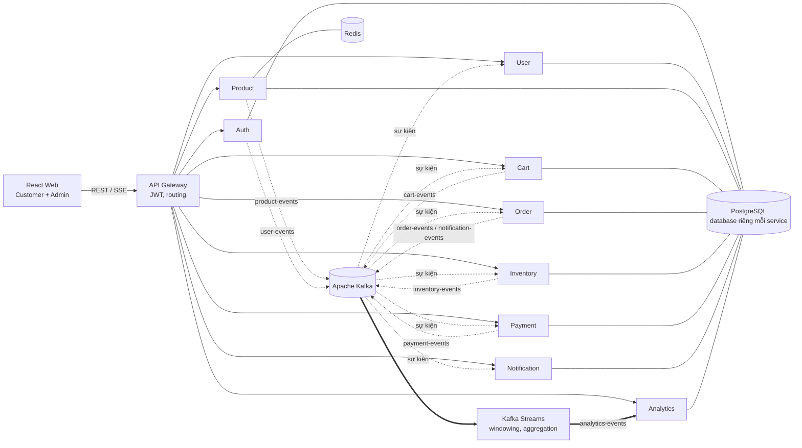

# Real-time E-commerce Analytics Platform

Nền tảng thương mại điện tử theo kiến trúc **Microservices + Event-driven**, dùng **Apache Kafka** để truyền sự kiện giữa các dịch vụ và **Kafka Streams** để tổng hợp, phân tích dữ liệu gần thời gian thực trên Dashboard.

**Công nghệ:** Java 21 · Spring Boot 3.5 · Spring Cloud Gateway · Apache Kafka 3.9 (KRaft) · Kafka Streams · PostgreSQL 16 · Redis 7 · React 18 + TypeScript · Apache ECharts · SSE · Docker Compose · JUnit 5 / Embedded Kafka / Testcontainers / k6



## 1. Chạy toàn bộ hệ thống (Docker Compose)

Yêu cầu: Docker Desktop (khuyến nghị cấp ≥ 8 GB RAM cho Docker).

```bash
cp .env.example .env          # tùy chọn: chỉnh cấu hình
docker compose up -d --build  # lần đầu build mất vài phút (Maven + npm)
docker compose ps             # chờ các service ở trạng thái running
```

| Thành phần | URL |
|---|---|
| Website khách hàng + trang quản trị | http://localhost:3000 |
| API Gateway | http://localhost:8080 |
| Kafka UI (topic, partition, message, consumer group) | http://localhost:8090 |
| Kafka (từ máy host) | `localhost:9094` |
| PostgreSQL | `localhost:5433` (shop / shop) – đổi bằng `POSTGRES_HOST_PORT` |

Khi khởi động lần đầu, dữ liệu mẫu được tạo tự động: 5 danh mục, 21 sản phẩm (kèm tồn kho phát qua sự kiện `ProductCreated`) và các tài khoản:

| Vai trò | Email | Mật khẩu |
|---|---|---|
| Admin | `admin@shop.local` | `Admin@123` |
| Product Manager | `pm@shop.local` | `Manager@123` |
| Warehouse Manager | `warehouse@shop.local` | `Manager@123` |
| Analyst | `analyst@shop.local` | `Analyst@123` |
| Customer | `customer@shop.local`, `customer1..50@shop.local` | `Customer@123` |

Dừng hệ thống: `docker compose down` (thêm `-v` để xóa dữ liệu).

## 2. Thử luồng đặt hàng xuyên dịch vụ

1. Đăng nhập `customer@shop.local` → thêm sản phẩm vào giỏ → **Đặt hàng**.
2. Trang chi tiết đơn hiển thị trạng thái chạy qua Saga: `PENDING → AWAITING_PAYMENT → CONFIRMED`; chuông thông báo nhận cập nhật realtime (SSE).
3. Đặt lại với phương thức **"Thẻ bị từ chối (kiểm thử)"** → đơn chuyển `CANCELLED`, kho được hoàn lại (hành động bù).
4. Mở tab ẩn danh, đăng nhập `admin@shop.local` → **Dashboard** cập nhật doanh thu, số đơn, trạng thái, top sản phẩm, cảnh báo, consumer lag Kafka mỗi giây.
5. Mở Kafka UI để xem các message trên `order-events`, `inventory-events`, `payment-events`, `analytics-events`...

### Khách hàng ảo (chạy sẵn khi `docker compose up`)

`simulator-service` liên tục tạo khách hàng ảo truy cập qua API Gateway như người thật: xem/tìm kiếm sản phẩm, thêm giỏ, bỏ giỏ, đặt hàng bằng thẻ/ví, thỉnh thoảng bị từ chối thẻ hoặc hủy đơn, đăng ký tài khoản mới. Mỗi khách có "tính cách" (tiết kiệm / bình thường / chịu chi), và một vài sản phẩm "hot" được mua nhiều hơn hẳn. Song song có **nhân viên kho ảo** (tự nhập hàng khi sắp hết) và **nhân viên giao hàng ảo** (CONFIRMED → SHIPPING → DELIVERED), nên hệ thống chạy được nhiều giờ liền mà không cạn hàng.

Điều khiển tại **http://localhost:3000/admin/simulator** (đăng nhập ADMIN): bật/tắt, chỉnh số lượt/phút, tỷ lệ bỏ giỏ / thẻ lỗi / hủy đơn, lưu lượng dao động theo giờ cao điểm, và nút **Mua dồn dập** để kích hoạt cảnh báo đột biến. Tắt tự chạy bằng `SIMULATOR_AUTOSTART=false` trong `.env`.

Tạo lưu lượng lớn cho Dashboard bằng k6 (≥ 10.000 sự kiện):

```bash
docker compose --profile loadtest run --rm k6 run /scripts/simulate-traffic.js
docker compose --profile loadtest run --rm k6 run -e BUYERS=200 /scripts/flash-sale.js
```

Chi tiết 3 kịch bản demo nâng cao (Real-time Sales, Flash Sale, Fault Tolerance): [docs/TESTING.md](docs/TESTING.md).

## 3. Phát triển cục bộ (không Docker cho service)

```bash
# Hạ tầng
docker compose up -d postgres redis kafka kafka-ui

# Build + test backend (cần JDK 21+ và Maven 3.9+)
mvn clean install

# Chạy từng service (mỗi service một terminal), ví dụ:
mvn -pl services/order-service spring-boot:run
# Service mặc định kết nối localhost:5432 / localhost:9094 / localhost:6379, gateway ở :8080
# PostgreSQL của Docker publish ra cổng 5433 → đặt DB_URL, ví dụ:
#   $env:DB_URL="jdbc:postgresql://localhost:5433/order_db"

# Frontend (Node 20+): proxy /api → http://localhost:8080
cd frontend && npm install && npm run dev   # http://localhost:5173
```

## 4. Kiểm thử

```bash
mvn test        # unit + integration test (Embedded Kafka, H2, TopologyTestDriver)
```

| Bộ test | Nội dung |
|---|---|
| `OrderSagaIntegrationTest` | Embedded Kafka: OrderCreated qua Outbox (TC01), thanh toán OK (TC02), thất bại → bù (TC03), hết hàng (TC04), sự kiện trùng (TC09), message hỏng → DLT (TC07) |
| `FlashSaleH2Test` / `FlashSalePostgresTest` | 50 người mua tranh 10 sản phẩm → đúng 10 đơn giữ được hàng, không âm kho; hoàn kho/xuất kho idempotent. Bản PostgreSQL chạy qua Testcontainers khi có Docker |
| `AnalyticsTopologyTest` | Kafka Streams: doanh thu theo cửa sổ 1m/5m/1h, hoàn tiền, đơn theo trạng thái, top sản phẩm, cảnh báo đột biến đúng 1 lần (TC05) |
| `PaymentServiceTest` | Xử lý đúng một lần, MOCK_FAIL, hoàn tiền khi hủy |
| `JwtAuthenticationFilterTest` | Public/protected route, chống giả mạo header, phân quyền 403, token qua query cho SSE |
| `*ContextTest` | Khởi tạo toàn bộ cấu hình Spring của từng service |

## 5. Cấu trúc thư mục

```
├── libs/
│   ├── common/              # Event envelope, payload, tên topic, JWT
│   └── service-support/     # Outbox, Idempotency, Retry + DLT, xử lý lỗi REST (auto-configuration)
├── services/
│   ├── api-gateway/         # Spring Cloud Gateway + JWT filter            :8080
│   ├── auth-service/        # Đăng ký, đăng nhập, JWT, phân quyền          :8081
│   ├── user-service/        # Hồ sơ, sổ địa chỉ                            :8082
│   ├── product-service/     # Sản phẩm, danh mục, tìm kiếm, cache Redis     :8083
│   ├── cart-service/        # Giỏ hàng                                     :8084
│   ├── order-service/       # Đơn hàng + điều phối Saga                    :8085
│   ├── inventory-service/   # Giữ / xuất / hoàn kho, cảnh báo tồn thấp      :8086
│   ├── payment-service/     # Thanh toán mô phỏng, hoàn tiền               :8087
│   ├── notification-service/# Thông báo + SSE                              :8088
│   ├── analytics-service/   # Kafka Streams + Dashboard SSE + báo cáo       :8089
│   └── simulator-service/   # Khách hàng ảo + nhân viên ảo tạo lưu lượng    :8091
├── frontend/                # React + TypeScript + ECharts (Nginx khi chạy Docker)
├── infra/postgres/          # Script tạo database cho từng service
├── docker/                  # Dockerfile dùng chung cho các service
├── scripts/k6/              # Kịch bản giả lập & kiểm thử tải
└── docs/                    # Kiến trúc, API, kiểm thử & demo
```

## 6. Tài liệu

- [docs/ARCHITECTURE.md](docs/ARCHITECTURE.md) – kiến trúc, topic, event schema, Saga, Outbox, idempotency, retry/DLQ, topology Kafka Streams.
- [docs/API.md](docs/API.md) – danh sách REST API qua Gateway.
- [docs/TESTING.md](docs/TESTING.md) – kế hoạch kiểm thử TC01–TC10, kịch bản demo A/B/C, đối chiếu tiêu chí nghiệm thu.
