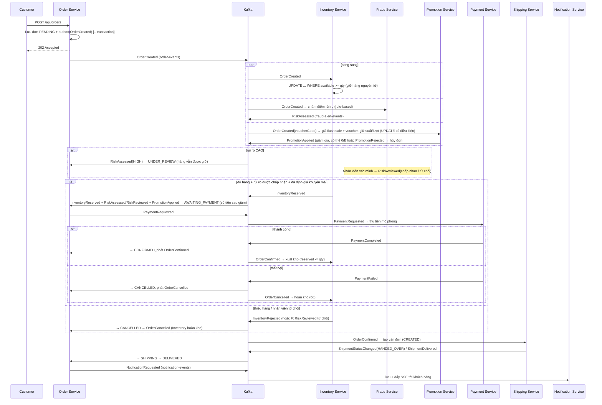
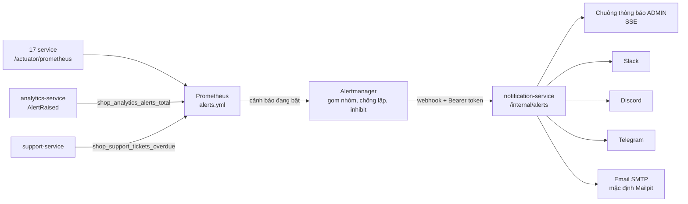

# Kiến trúc hệ thống

## 1. Nguyên tắc

- **Mỗi service một miền nghiệp vụ, một database riêng** (`auth_db`, `order_db`, ...). Không service nào đọc bảng của service khác.
- **REST** cho yêu cầu cần phản hồi ngay (xem sản phẩm, tạo đơn, quản trị). **Kafka** cho mọi tương tác giữa các service.
- Service khác cần dữ liệu sản phẩm (giá, tên) thì **tự duy trì read-model** từ `product-events` (Order: `product_snapshots`, Cart: `catalog_items`, Inventory: `inventories`) → không có lời gọi đồng bộ giữa các service, một service chết không kéo theo service khác.
- **API Gateway** là điểm vào duy nhất: xác thực JWT, gắn `X-User-Id / X-User-Email / X-User-Roles` cho service phía sau và **xóa các header này nếu client tự gửi** (chống giả mạo). Service vẫn kiểm tra quyền chi tiết (phòng thủ 2 lớp).

## 2. Kafka topics

| Topic | Producer | Consumer | Sự kiện |
|---|---|---|---|
| `user-events` | auth | user, analytics, fraud, loyalty | UserRegistered (kèm `referralCode`), UserLoggedIn, UserRolesChanged |
| `product-events` | product | order, cart, inventory, promotion, recommendation | ProductCreated, ProductUpdated, ProductDiscontinued |
| `user-activity-events` | product | analytics, recommendation | ProductViewed, SearchPerformed |
| `cart-events` | cart | analytics, recommendation | CartItemAdded, CartItemUpdated, CartItemRemoved, CartCleared |
| `order-events` | order | inventory, payment, cart, analytics, fraud, shipping, loyalty, review, promotion, support, recommendation | OrderCreated, PaymentRequested, OrderConfirmed, OrderCancelled, OrderStatusChanged |
| `inventory-events` | inventory | order, analytics | InventoryReserved, InventoryRejected, InventoryCommitted, InventoryReleased, StockUpdated, StockLow |
| `payment-events` | payment | order, analytics, fraud | PaymentCompleted, PaymentFailed, PaymentRefunded |
| `fraud-alert-events` | fraud | order, analytics | RiskAssessed (mọi đơn), OrderFlagged (cần xác minh), RiskReviewed |
| `shipping-events` | shipping | order, analytics | ShipmentCreated, ShipmentStatusChanged, ShipmentDelivered |
| `loyalty-events` | loyalty | promotion | PointsEarned, PointsReversed, TierChanged, PointsRedeemed (đổi điểm → voucher) |
| `promotion-events` | promotion | order, analytics | PromotionApplied (mọi đơn, kể cả giảm 0đ), PromotionRejected, PromotionReleased (đơn hủy → hoàn suất/lượt), VoucherIssued |
| `support-events` | support | analytics | TicketCreated, TicketStatusChanged, TicketMessagePosted |
| `audit-events` | mọi service có thao tác quản trị / bảo mật | audit | AuditRecorded |
| `review-events` | review | loyalty, analytics, recommendation | ReviewSubmitted, ReviewVisibilityChanged |
| `notification-events` | order, inventory, payment, fraud, loyalty, review, promotion, audit, support | notification | NotificationRequested |
| `analytics-events` | Kafka Streams (analytics) | analytics (dashboard) | MetricUpdated, AlertRaised |
| `<topic>-dlt` | Spring Kafka error handler | (vận hành) | Message lỗi sau khi hết số lần retry |

Mỗi topic nghiệp vụ có 3 partition; **key = aggregateId** (orderId, productId, userId) nên mọi sự kiện của cùng một đơn hàng nằm trên cùng partition và được xử lý **đúng thứ tự**. Mỗi listener là một consumer group riêng (`order-service.payment-events`, `inventory-service.order-events`, ...) với `concurrency = 3` = số partition (TC10).

### Event schema (envelope)

```json
{
  "eventId": "5b0e0f2e-8d1f-4a3e-9c55-0e7a1f0c2a11",
  "eventType": "OrderCreated",
  "version": 1,
  "occurredAt": "2026-11-19T03:15:22.481Z",
  "source": "order-service",
  "aggregateId": "1024",
  "payload": { "orderId": 1024, "userId": 7, "items": [ ... ], "totalAmount": 3700000, "paymentMethod": "MOCK_CARD",
               "shippingAddress": "1 Lê Lợi, Q1", "shippingFee": 0 },
  "correlationId": "9c1f2a7e-3b4d-4e5f-8a6b-7c8d9e0f1a2b"
}
```

Định nghĩa trong [`libs/common`](../libs/common/src/main/java/com/shop/common/event). `version` cho phép tiến hóa schema (có thể thay bằng Schema Registry ở giai đoạn sau); khi đọc chấp nhận cả tên `eventVersion`. Các trường mới đều được **thêm vào cuối và cho phép thiếu** (message cũ không có `correlationId`, `shippingAddress`, `referralCode` vẫn đọc được) — tiến hóa schema tương thích ngược.

### Truy vết bằng correlationId

```
Client ──X-Correlation-Id──▶ Gateway (tạo nếu thiếu) ──▶ Service (CorrelationFilter → MDC + thread)
   ──▶ OutboxService ghi correlation_id ──▶ OutboxRelay gửi header "correlationId"
   ──▶ Consumer (CorrelationRecordInterceptor gắn vào thread) ──▶ sự kiện phát tiếp mang CÙNG correlationId
```

Một lần đặt hàng → OrderCreated, RiskAssessed, InventoryReserved, PaymentRequested, PaymentCompleted, OrderConfirmed, ShipmentCreated... đều chung một correlationId; log mọi service in dạng `[<correlationId>]` nên có thể lọc trọn luồng Saga. Hạ tầng nằm ở `libs/service-support/.../correlation`.

## 3. Luồng đặt hàng – Saga (orchestration bởi Order Service)



Máy trạng thái đơn hàng ([`OrderStatus`](../services/order-service/src/main/java/com/shop/order/domain/OrderStatus.java)):

```
            ┌─RiskAssessed(HIGH)─▶ UNDER_REVIEW ─duyệt─┐
PENDING ────┴──(đã giữ hàng + rủi ro chấp nhận)───────┴─▶ AWAITING_PAYMENT → CONFIRMED → SHIPPING → DELIVERED
   └──────────────┴─────────────────────┴─────────────────────┴──→ CANCELLED
```

Đơn chỉ được yêu cầu thanh toán khi **đủ ba điều kiện** (lưu trên `orders`: `inventory_reserved`, `risk_cleared`, `promotion_cleared`): Inventory đã giữ hàng, rủi ro được chấp nhận (tự động hoặc do nhân viên) **và** Promotion Service đã định giá (`PromotionApplied` trừ giảm giá vào `total_amount`). Các phản hồi đến theo thứ tự bất kỳ. `FRAUD_CHECK_ENABLED=false` / `PROMOTION_CHECK_ENABLED=false` bỏ qua điều kiện tương ứng; đơn tạo trước phiên bản 2.1 (`promotion_cleared` NULL) không phải chờ.

**Timeout & bù:** `OrderTimeoutJob` quét định kỳ, đơn kẹt ở `PENDING/AWAITING_PAYMENT` quá `ORDER_TIMEOUT` (mặc định 2 phút) hoặc ở `UNDER_REVIEW` quá `ORDER_REVIEW_TIMEOUT` (mặc định 30 phút) bị hủy → `OrderCancelled` → Inventory hoàn kho, Payment **tự hoàn tiền** nếu đã thu (kể cả khi kết quả thanh toán đến muộn), Fraud đóng hồ sơ, Shipping hủy vận đơn chưa giao, Loyalty trừ lại điểm. Khách/admin hủy đơn đã xác nhận cũng đi qua cùng cơ chế.

**Giao hàng:** trạng thái `SHIPPING`/`DELIVERED` không còn được đặt tay ở Order Service mà do Shipping Service phát (`HANDED_OVER`/`IN_TRANSIT` → SHIPPING, `DELIVERED` → DELIVERED). `PUT /api/orders/{id}/status` chỉ còn dùng để hủy.

## 4. Độ tin cậy

| Cơ chế | Hiện thực |
|---|---|
| **Transactional Outbox** | [`OutboxService`](../libs/service-support/src/main/java/com/shop/support/outbox/OutboxService.java) ghi sự kiện vào bảng `outbox_events` trong cùng transaction với dữ liệu nghiệp vụ; [`OutboxRelay`](../libs/service-support/src/main/java/com/shop/support/outbox/OutboxRelay.java) publish theo thứ tự, dừng ở lỗi đầu tiên và thử lại. Không còn trường hợp "DB đã commit nhưng sự kiện mất". |
| **Idempotent consumer** | [`IdempotencyGuard`](../libs/service-support/src/main/java/com/shop/support/outbox/IdempotencyGuard.java): `INSERT INTO processed_events ... ON CONFLICT DO NOTHING` trong cùng transaction với xử lý → sự kiện gửi lại (at-least-once) không gây tác động trùng (TC09). Thêm ràng buộc nghiệp vụ: mỗi đơn chỉ một payment, reservation unique theo (order, product). |
| **Retry + backoff** | `DefaultErrorHandler` với exponential backoff (500ms × 2, 3 lần). |
| **Dead Letter Topic** | Hết retry → message sang `<topic>-dlt`. Message sai định dạng (`MalformedEventException`) vào DLT ngay, không chặn partition (TC07). |
| **Chống bán vượt** | Giữ hàng bằng `UPDATE inventories SET available = available - :q ... WHERE available >= :q`; nhiều dòng được khóa theo thứ tự productId để tránh deadlock. |
| **Truy vết** | correlationId xuyên HTTP → Outbox → Kafka header → consumer → sự kiện kế tiếp; in trong mọi dòng log. |
| **Phục hồi** | Consumer commit offset sau khi xử lý xong; dừng/khởi động lại service sẽ tiếp tục từ offset cuối (TC06). Kafka Streams thread lỗi được thay thế (`REPLACE_THREAD`). |

## 5. Analytics – Kafka Streams

Topology: [`AnalyticsTopology`](../services/analytics-service/src/main/java/com/shop/analytics/streams/AnalyticsTopology.java)

| Chỉ số | Nguồn | Kỹ thuật |
|---|---|---|
| Doanh thu 1 phút / 5 phút / 1 giờ | payment-events (Completed − Refunded) | Tumbling window + aggregate |
| Tổng doanh thu, số giao dịch | payment-events | KTable aggregate |
| Đơn mới / phút + **cảnh báo đột biến** | order-events | Windowed count, alert khi vượt ngưỡng (1 lần/cửa sổ) |
| Thanh toán lỗi / phút + cảnh báo | payment-events | Windowed count |
| Đơn theo trạng thái | order-events | `toTable` (trạng thái mới nhất mỗi đơn) → `groupBy(status).count()` (tự trừ trạng thái cũ) |
| Top sản phẩm bán chạy | OrderConfirmed (trừ lại nếu hủy sau xác nhận) | flatMap item → aggregate theo productId |
| Người dùng hoạt động 5 phút | user/cart/order/user-activity events | Hopping window 5m/1m, tập userId duy nhất |
| Phễu: xem sản phẩm → thêm giỏ → tạo đơn → thanh toán → xác nhận | user-activity + mọi topic | Bộ đếm KTable (kèm số tìm kiếm, giao thành công, đánh giá) |
| Tồn kho thấp | inventory-events | StockUpdated / StockLow → alert |
| Đơn nghi ngờ gian lận | fraud-alert-events | OrderFlagged → alert ORDER_FLAGGED (kèm lý do) |
| Hiệu suất Kafka | AdminClient | Consumer lag theo group, msg/s theo topic ([`KafkaMonitor`](../services/analytics-service/src/main/java/com/shop/analytics/monitor/KafkaMonitor.java)) |

Kết quả ghi lên `analytics-events` → `AnalyticsEventsConsumer` cập nhật trạng thái Dashboard trong bộ nhớ + upsert vào bảng tổng hợp (`sales_aggregates`, `product_statistics`, `event_statistics`, `analytics_alerts`). Dashboard **không bao giờ truy vấn bảng nghiệp vụ**. Trình duyệt nhận snapshot qua SSE tối đa 1 lần/giây (throttle) và cảnh báo ngay lập tức.

## 6. Bảo mật

- Mật khẩu băm BCrypt; JWT HS256 (`JWT_SECRET` dùng chung Auth ↔ Gateway, cấu hình qua biến môi trường).
- SSE dùng `?access_token=` vì `EventSource` không gửi được header; Gateway chấp nhận cả hai cách.
- Gateway: route công khai (đăng nhập, đăng ký, xem sản phẩm/danh mục, tồn kho khả dụng, đánh giá/hỏi đáp, kiểm tra mã giới thiệu, danh mục phần thưởng, flash sale & voucher công khai); `/api/analytics/**` chỉ cho nhân viên; `/api/auth/users/**` và `/api/audit/**` chỉ ADMIN; `/api/fraud/**` ADMIN/ANALYST; `/api/reviews/admin/**` ADMIN/PRODUCT_MANAGER; `/api/promotions/admin/**` ADMIN/PRODUCT_MANAGER/ANALYST (service chỉ cho ADMIN/PRODUCT_MANAGER ghi); `/api/shipments/**` nhân viên, riêng `/api/shipments/orders/**` cho chủ đơn (service kiểm tra quyền sở hữu).
- **Rate limit** ([`RateLimitFilter`](../services/api-gateway/src/main/java/com/shop/gateway/ratelimit/RateLimitFilter.java), chạy sau JWT filter): cửa sổ cố định 1 phút, bộ đếm trong Redis (đúng khi chạy nhiều instance Gateway). Đăng nhập/đăng ký theo IP, đặt hàng và báo giá voucher theo người dùng (chống bot gom flash sale, chống dò mã), còn lại theo người dùng hoặc IP. Redis lỗi → cho qua (fail-open) để không làm sập cửa hàng.
- **IP client** ([`ClientIp`](../services/api-gateway/src/main/java/com/shop/gateway/ClientIp.java)): chỉ tin `X-Real-IP` (Nginx đặt) khi kết nối đến từ mạng nội bộ; Gateway xóa `X-Client-Ip` do client gửi và gắn lại giá trị tự xác định cho service phía sau.
- **Chống dò mật khẩu**: sai 5 lần liên tiếp → tạm khóa 5 phút (423); email không tồn tại trả cùng lỗi và cùng thời gian xử lý (so khớp BCrypt giả) như sai mật khẩu.
- **Actuator không công khai**: actuator của Gateway chạy ở cổng quản trị 9080 (không publish); các service khác không publish cổng ra host. Prometheus chỉ mở trên `127.0.0.1`.

## 7. Dịch vụ mở rộng (Ecommerce 2.0)

Theo tài liệu "Đề xuất nâng cấp Ecommerce 2.0", đợt này bổ sung nền tảng sự kiện (correlationId, user-activity-events) và giai đoạn 6–7: Fraud, Loyalty, Shipping, Review. Mỗi service có database riêng (`fraud_db`, `loyalty_db`, `shipping_db`, `review_db`), dùng chung Outbox / IdempotencyGuard / Retry + DLT của `service-support`, **không gọi REST sang service khác**.

| Service | Cổng | Tiêu thụ | Phát | Read-model / dữ liệu riêng |
|---|---|---|---|---|
| `fraud-service` | 8092 | order, payment, user-events | fraud-alert-events, notification-events | `order_records`, `payment_failures`, `customer_profiles`, `risk_cases` |
| `shipping-service` | 8094 | order-events | shipping-events | `shipments`, `shipment_events` (timeline) |
| `loyalty-service` | 8093 | user, order, review-events | loyalty-events, notification-events | `loyalty_accounts`, `point_transactions` (sổ cái) |
| `review-service` | 8095 | order-events | review-events, notification-events | `purchases` (ai đã nhận hàng gì), `reviews`, `questions`, `answers` |

### Fraud Detection – chấm điểm rule-based ([`RiskRules`](../services/fraud-service/src/main/java/com/shop/fraud/service/RiskRules.java))

| Luật | Điều kiện mặc định | Điểm |
|---|---|---|
| HIGH_VALUE / VERY_HIGH_VALUE | đơn ≥ 50 triệu / ≥ 100 triệu | +30 / +50 |
| VELOCITY | ≥ 4 đơn khác trong 10 phút | +30 |
| CANCEL_HISTORY | ≥ 3 đơn bị hủy trong 24 giờ | +20 |
| PAYMENT_FAILURES | ≥ 2 thanh toán lỗi trong 1 giờ | +25 |
| NEW_ACCOUNT | tài khoản < 24 giờ đặt đơn ≥ 10 triệu | +25 |
| BULK_QUANTITY | tổng số lượng ≥ 30 | +20 |
| SHARED_ADDRESS | địa chỉ (chuẩn hóa, bỏ dấu) được ≥ 2 tài khoản khác dùng trong 7 ngày | +25 |

Điểm tối đa 100. **Cần xác minh khi tổng ≥ 70 VÀ ≥ 2 tín hiệu** — không luật đơn lẻ nào đủ để chặn đơn (không kết luận gian lận từ một dấu hiệu); MEDIUM (≥ 40) chỉ ghi nhận. Mỗi tín hiệu kèm giải thích tiếng Việt hiển thị cho nhân viên. Ngưỡng cấu hình qua `shop.fraud.*`. Đơn cũ hơn `max-event-age` (khi đọc lại lịch sử topic) chỉ được lưu làm thống kê, không chấm điểm.

### Shipping

Vận đơn tạo khi nhận `OrderConfirmed` (đơn ≥ 10 triệu đi GHN, còn lại chia GHTK / Viettel Post; mã vận đơn = mã ĐVVC + orderId). Vòng đời `CREATED → PACKED → HANDED_OVER → IN_TRANSIT → DELIVERED` (+ `CANCELLED` khi đơn bị hủy); nhân viên chỉ đi được bước kế tiếp, đổi ĐVVC trước khi bàn giao. Các `OrderStatusChanged(SHIPPING/DELIVERED)` cũ được đồng bộ ngược **không phát sự kiện** (tránh vòng lặp, đúng cả khi replay).

### Loyalty

1 điểm / 10.000 ₫ của đơn được xác nhận × hệ số hạng (Đồng 1.0 · Bạc 1.2 từ 5 triệu · Vàng 1.5 từ 20 triệu · Bạch kim 2.0 từ 50 triệu, theo chi tiêu 12 tháng). Nhiệm vụ: đơn đầu tiên +200, đánh giá +50 (tối đa 5 lần/24h). Giới thiệu: mã `SHOPxxxxxx`, người giới thiệu +500 khi người được giới thiệu có đơn đầu tiên. Hủy đơn / ẩn đánh giá → trừ lại mọi khoản thưởng gắn với đơn/đánh giá đó (`REVERSAL`). Ràng buộc duy nhất `(user, type, referenceId)` chặn thưởng trùng. Thông báo chỉ gửi cho sự kiện mới (≤ 10 phút) để replay lịch sử không spam.

Đổi điểm (2.1): `POST /api/loyalty/rewards/{id}/redeem` khóa dòng tài khoản (`SELECT ... FOR UPDATE`), ghi giao dịch `REDEMPTION` (âm, không bị trừ lại khi đơn hủy) và phát `PointsRedeemed` kèm thông số voucher; Promotion Service phát voucher cá nhân (idempotent theo `redemptionId`). Danh mục phần thưởng cấu hình ở `shop.loyalty.rewards`.

### Review

Chỉ người có đơn **đã giao** chứa sản phẩm mới được đánh giá (read-model `purchases` từ OrderConfirmed + OrderStatusChanged(DELIVERED), xóa khi OrderCancelled), mỗi người một đánh giá/sản phẩm. Hỏi đáp: khách hỏi; nhân viên (ADMIN/PRODUCT_MANAGER) hoặc người đã mua trả lời, người hỏi nhận thông báo. Nhân viên có thể ẩn đánh giá (kèm lý do).

### Hành vi người dùng

Product Service ghi `ProductViewed` (xem chi tiết) và `SearchPerformed` (tìm kiếm có từ khóa) lên `user-activity-events` qua Outbox, best-effort (lỗi ghi nhận không làm hỏng request). Analytics dùng cho phễu **xem → thêm giỏ → đặt hàng → thanh toán → xác nhận**, KPI tỷ lệ xem→đặt hàng và người dùng hoạt động; đồng thời là dữ liệu chính của Recommendation Service (mục 10).

### Lưu ý triển khai

- `ddl-auto=update` không sửa ràng buộc CHECK mà Hibernate 6 tạo cho cột enum → [`OrderSchemaPatches`](../services/order-service/src/main/java/com/shop/order/domain/OrderSchemaPatches.java) bỏ ràng buộc cũ để lưu được `UNDER_REVIEW` trên database cũ. Cột mới thêm vào bảng có sẵn đều cho phép NULL.
- `init.sql` chạy lại an toàn; service `db-init` trong docker-compose chạy nó mỗi lần `up` để volume cũ có thêm 4 database mới.
- Các service mới đọc topic từ đầu (`auto-offset-reset: earliest`): Loyalty tự tích điểm cho đơn cũ, Review/Shipping dựng lại read-model; Fraud và thông báo bỏ qua sự kiện cũ.

## 8. Khuyến mãi, bảo mật & vận hành (Ecommerce 2.1)

| Service | Cổng | Tiêu thụ | Phát | Dữ liệu riêng |
|---|---|---|---|---|
| `promotion-service` | 8096 | product, order, loyalty-events | promotion-events, notification-events, audit-events | `catalog_items` (read-model), `flash_sales`, `flash_sale_items`, `vouchers`, `usage_counters`, `redemptions` |
| `audit-service` | 8097 | audit-events | notification-events (cảnh báo bảo mật cho ADMIN) | `audit_entries` (chỉ thêm, không sửa) |

### Định giá khuyến mãi trong Saga

Promotion Service nhận **mọi** `OrderCreated` (kèm `voucherCode` nếu có) và luôn trả lời, nên Order Service biết khi nào giá đã chốt:

1. [`PricingEngine`](../services/promotion-service/src/main/java/com/shop/promotion/service/PricingEngine.java) (thuần, không truy cập DB) – áp giá flash sale từng dòng nếu còn suất và chưa vượt giới hạn mỗi khách; voucher (PERCENT có trần / FIXED / FREE_SHIPPING) tính trên tiền hàng **sau** flash sale; làm tròn xuống đồng. Cùng logic phục vụ `POST /api/promotions/quote` ở checkout.
2. Giữ suất/lượt bằng **UPDATE có điều kiện** ([`PromotionLedger`](../services/promotion-service/src/main/java/com/shop/promotion/service/PromotionLedger.java)): `sold = sold + q WHERE sold + q <= quota`, bộ đếm mỗi tài khoản `used + q <= limit`, voucher `used < usage_limit`. Một bước thất bại (đơn khác vừa giành suất cuối) → hoàn các bước đã làm trong cùng transaction rồi `PromotionRejected`.
3. Có bất kỳ điều kiện nào không thỏa (mã hết hạn/hết lượt, hết suất, đơn chưa đủ mức tối thiểu) → đơn bị **hủy kèm lý do** thay vì tính một giá khác với giá khách đã thấy.
4. `OrderCancelled` → hoàn suất flash sale và lượt dùng mã (bảng `redemptions` ghi lại mọi ưu đãi đã giữ, đồng thời là nguồn số liệu thống kê).

Order Service lưu `item_discount`, `voucher_discount`, giá flash sale từng dòng (`order_items.sale_price`) và tính `total_amount = tiền hàng niêm yết + phí ship − giảm giá`; `PaymentRequested` và `OrderConfirmed` mang số tiền sau giảm (doanh thu trên Dashboard, điểm Loyalty tính theo số tiền thực trả). Fraud chấm điểm trên giá trị tạm tính (trước giảm) – thận trọng hơn.

Voucher cá nhân (`owner_user_id`) chỉ chủ sở hữu dùng được – người khác nhập mã nhận thông báo "không tồn tại". Promotion Service bỏ qua `OrderCreated` cũ hơn `max-event-age` (khi đọc lại topic từ đầu lần chạy đầu tiên).

### Nhật ký kiểm toán

[`AuditTrail`](../libs/service-support/src/main/java/com/shop/support/audit/AuditTrail.java) (service-support) ghi `AuditRecorded` qua **Outbox trong cùng transaction** với thao tác → có nhật ký khi và chỉ khi thao tác được commit; riêng thất bại (đăng nhập sai) ghi bằng transaction riêng (`REQUIRES_NEW`) để không mất khi request lỗi. Mỗi bản ghi kèm người thao tác, vai trò, IP client (do Gateway xác định), service nguồn và **correlationId** – từ một dòng audit tra được toàn bộ log/sự kiện liên quan.

Audit Service phát cảnh báo cho ADMIN khi có tài khoản bị tạm khóa, hoặc khi một IP đăng nhập sai vào ≥ 5 tài khoản khác nhau trong 10 phút (nghi ngờ credential stuffing; cảnh báo một lần khi vượt ngưỡng).

### Giám sát (Prometheus + Grafana)

- Mọi service có `/actuator/prometheus` (Micrometer); nhãn `application` thêm tự động bởi [`MetricsEnvironmentPostProcessor`](../libs/service-support/src/main/java/com/shop/support/metrics/MetricsEnvironmentPostProcessor.java), histogram `http.server.requests` để tính p95.
- Metric riêng: `shop_outbox_pending` (sự kiện chưa relay), `shop_kafka_dlt_total{topic}` (message vào DLT), `shop_gateway_rate_limited_total{rule}`, `shop_auth_logins_total{result}`, `shop_promotion_evaluations_total{result}`, `shop_promotion_discount_amount_total`; kèm metric chuẩn JVM, Hikari, Kafka consumer lag.
- [`infra/prometheus/alerts.yml`](../infra/prometheus/alerts.yml): ServiceDown, HighErrorRate, SlowResponses, OutboxBacklog, MessagesInDeadLetterTopic, KafkaConsumerLag, DatabasePoolExhausted (đúng sự cố "too many clients" từng gặp), HighHeapUsage, LoginFailureSpike, RateLimitTriggered.
- Grafana tự nạp datasource và dashboard [`shop-overview.json`](../infra/grafana/dashboards/shop-overview.json): tình trạng chung, HTTP (rps, p95, lỗi, 429), Kafka & outbox, tài nguyên (heap, kết nối DB), bảo mật & khuyến mãi.

### Lưu ý triển khai (2.1)

- 15 service dùng chung một PostgreSQL: `max_connections=200`, pool mỗi service `DB_POOL_SIZE=5`. Thêm service mới cần kiểm tra lại ngân sách kết nối.
- `point_transactions.type` có giá trị mới `REDEMPTION` → [`LoyaltySchemaPatches`](../services/loyalty-service/src/main/java/com/shop/loyalty/domain/LoyaltySchemaPatches.java) bỏ CHECK constraint cũ (cùng cách với `OrderSchemaPatches`). Cột mới (`users.failed_login_attempts`, `users.locked_until`, các cột khuyến mãi trên `orders`/`order_items`) đều cho phép NULL.
- Cột giá trị voucher tên `discount_value` (`VALUE` là từ khóa SQL của H2).

## 9. Cảnh báo qua email/chat & Hỗ trợ khách hàng (Ecommerce 2.2)

### Luồng cảnh báo



- **Alertmanager** ([`alertmanager.yml`](../infra/alertmanager/alertmanager.yml)) gom cảnh báo theo `alertname + service/application/rule/type`, chờ 30 giây (10 giây với `critical`) để gộp, nhắc lại sau 4 giờ (1 giờ với `critical`), gửi cả thông báo **đã khôi phục**. `ServiceDown` chặn các cảnh báo warning/info của cùng service để tránh "bão" tin nhắn; mọi `ServiceDown` gom chung một nhóm và luật chỉ bật sau 3 phút (18 JVM cần 1–2,5 phút để khởi động) → khởi động lại cả hệ thống không còn gửi hàng chục email. notification-service cũng gộp mọi cảnh báo trong một webhook thành **một** tin nhắn liệt kê từng đối tượng.
- **notification-service** ([`AlertRelayService`](../services/notification-service/src/main/java/com/shop/notification/alerting/AlertRelayService.java)) định dạng nội dung tiếng Việt (mức độ, đối tượng, thời điểm theo giờ Việt Nam, link Grafana), tạo thông báo trong ứng dụng cho mọi ADMIN **không qua Kafka** (cảnh báo vẫn đến khi Kafka gặp sự cố), rồi gửi tới từng kênh đã cấu hình. Lỗi một kênh chỉ được ghi lại (`alert_events.deliveries`, metric `shop_alerting_deliveries_total{channel,result}` → cảnh báo `AlertDeliveryFailing`), webhook vẫn trả 200 để Alertmanager không gửi lại gây trùng ở các kênh đã nhận.
- Kênh cấu hình bằng biến môi trường (`ALERT_SLACK_WEBHOOK_URL`, `ALERT_DISCORD_WEBHOOK_URL`, `ALERT_TELEGRAM_BOT_TOKEN` + `ALERT_TELEGRAM_CHAT_ID`, `ALERT_EMAIL_TO` + `SMTP_*`); để trống = tắt. Mặc định email đi vào **Mailpit** (hộp thư giả lập, không gửi ra Internet).
- **Cảnh báo nghiệp vụ** của Kafka Streams (đơn tăng đột biến, thanh toán lỗi, tồn kho thấp, đơn nghi gian lận) được đếm thành `shop_analytics_alerts_total{type,severity}` khi Dashboard nhận cảnh báo mới (bỏ qua khi đọc lại topic lúc khởi động) → luật `BusinessAlert` → cùng đường đi ra email/chat.
- Webhook `/internal/alerts` không có route qua Gateway, cổng service không publish ra host, và vẫn kiểm tra Bearer token (so sánh thời gian hằng).

### Support Service

| Service | Cổng | Tiêu thụ | Phát | Dữ liệu riêng |
|---|---|---|---|---|
| `support-service` | 8098 | order-events | support-events, notification-events, audit-events | `tickets`, `ticket_messages`, `order_refs` (read-model) |

Package Java là `com.shop.helpdesk` (không dùng `com.shop.support` – đã thuộc thư viện `service-support`).

```
OPEN ──CSKH trả lời──▶ IN_PROGRESS ──▶ WAITING_CUSTOMER ──khách trả lời──▶ IN_PROGRESS / OPEN
  │                       │                                                      │
  └───────────────────────┴──────────▶ RESOLVED ──3 ngày không phản hồi──▶ CLOSED
                                         │  ▲
                              khách trả lời└─┘ (mở lại)
```

- Khách chỉ gắn được **đơn của chính mình** (kiểm tra trên read-model `order_refs` từ order-events – không gọi REST sang Order Service). Đơn liên quan đổi trạng thái (giao, hủy kèm lý do...) → tin nhắn hệ thống trong mọi yêu cầu đang mở của đơn đó (chỉ với sự kiện mới).
- **SLA phản hồi đầu tiên** theo mức ưu tiên; chủ đề thanh toán hoặc đơn ≥ 10 triệu mặc định ưu tiên Cao. `SupportJobs` mỗi phút tìm yêu cầu vừa quá hạn → báo nhân viên CSKH (mỗi yêu cầu một lần); gauge `shop_support_tickets_overdue` → cảnh báo `SupportTicketsOverdue` qua Alertmanager. Yêu cầu đã giải quyết tự đóng sau 3 ngày.
- **Chat realtime** qua SSE ([`SupportHub`](../services/support-service/src/main/java/com/shop/helpdesk/service/SupportHub.java)): kênh theo yêu cầu (khách + nhân viên đang mở) và kênh hàng đợi CSKH; chỉ đẩy sau khi transaction commit. Một instance – khi scale ngang cần phát qua `support-events` tới mọi instance.
- Đếm tin chưa đọc riêng cho khách / nhân viên; khách trả lời yêu cầu đã giải quyết → mở lại; đánh giá 1–5 sao một lần sau khi giải quyết. Thao tác của nhân viên (nhận xử lý, đổi trạng thái, ưu tiên) ghi audit.
- Vai trò mới `SUPPORT_AGENT` (tài khoản mẫu `support@shop.local`, tạo cả trên CSDL cũ): xem Dashboard, xử lý hàng đợi CSKH; `ANALYST` chỉ xem.

### Analytics bổ sung

| Chỉ số | Nguồn | Kỹ thuật |
|---|---|---|
| Giảm giá khuyến mãi ròng + số đơn hưởng ưu đãi | promotion-events: `PromotionApplied` (giảm > 0) cộng, `PromotionReleased` (đơn hủy) trừ | KTable aggregate |
| Yêu cầu hỗ trợ tạo mới / đã giải quyết | support-events | Bộ đếm (`TicketStatusChanged` → RESOLVED) |

## 10. Gợi ý sản phẩm & Dashboard khởi động nhanh (Ecommerce 2.3)

### Recommendation Service (cổng 8099, `recommendation_db`)

Bộ gợi ý **lai, học trực tuyến** từ luồng sự kiện – không có job huấn luyện theo lô, không gọi REST sang service khác:

| Nguồn | Học được gì |
|---|---|
| product-events | Danh mục (tên, danh mục, giá, ảnh, còn bán) – read-model `rec_products` |
| order-events (`OrderConfirmed`) | Cặp **mua cùng** (`rec_pairs` kind `BOUGHT`, +1 mỗi cặp trong một đơn), số đơn chứa sản phẩm, lượt mua theo ngày, hành vi `BUY` của khách, **chuyển đổi** từ gợi ý |
| user-activity-events | Cặp **cùng xem** (cùng khách trong 30 phút, kind `VIEWED`), lượt xem theo ngày (cả khách vãng lai), hành vi `VIEW` / `SEARCH` |
| cart-events (`CartItemAdded`) | Lượt thêm giỏ theo ngày, hành vi `CART` |
| review-events | Tổng/số điểm đánh giá đang hiển thị → hệ số chất lượng |

Mọi thống kê dùng `occurredAt` của sự kiện, có `IdempotencyGuard`; consumer đọc từ đầu topic nên khi triển khai lần đầu mô hình được dựng từ toàn bộ lịch sử. Bộ đếm tăng bằng `INSERT … ON CONFLICT DO NOTHING` + `UPDATE x = x + ?` (an toàn với 3 consumer thread).

Chấm điểm ([`Scoring`](../services/recommendation-service/src/main/java/com/shop/recommendation/engine/Scoring.java) – hàm thuần, có test):

- **Độ tương đồng item-item**: cosine `cùng(A,B) / √(n(A)·n(B))` nhân độ tin cậy `cùng / (cùng + 2)` – một cặp chỉ xuất hiện một lần không lấn át cặp có nhiều bằng chứng.
- **Nội dung** (cold start): cùng danh mục 60%, giá tương đương 25% (giảm về 0 khi chênh 4 lần), tên giống nhau 15% (Jaccard, bỏ dấu tiếng Việt).
- **Thịnh hành**: Σ (xem + 3×giỏ + 5×mua) × 0,5^(tuổi/2 ngày) trong 7 ngày.
- **Hồ sơ sở thích**: xem 1, giỏ 3, mua 5, tìm kiếm 0,5 × 0,5^(tuổi/3 ngày), trong 30 ngày.
- **Chất lượng**: điểm đánh giá trung bình Bayes (giả định 3,5★ × 5 đánh giá) → hệ số 0,9–1,1.
- **Đa dạng hóa**: mỗi danh mục tối đa ~1/3 danh sách "Dành cho bạn" trước khi bù.

"Dành cho bạn" = láng giềng (cùng xem 60% / mua cùng 40%) của tối đa 8 sản phẩm khách tương tác mạnh nhất + thịnh hành trong 2 danh mục quan tâm nhất + sản phẩm khớp 3 từ khóa tìm gần nhất; bỏ sản phẩm khách đã tương tác; thiếu thì bù bằng thịnh hành rồi sản phẩm mới. Mỗi gợi ý giữ **lý do** của thành phần đóng góp nhiều nhất.

**Đo hiệu quả**: mỗi lần trả gợi ý cộng `requests`/`impressions` cho vị trí (`rec_placement_stats`); frontend gửi `POST /clicks` khi khách bấm; `OrderConfirmed` chứa sản phẩm khách đã bấm trong 24 giờ → `conversions` + doanh thu (lượt bấm cuối, mỗi lượt bấm tính một lần). Metric `shop_recommendation_served_total`, `_clicks_total`, `_conversions_total` theo `placement`. Trang quản trị `/admin/recommendations` hiển thị CTR, chuyển đổi và giải thích gợi ý của từng khách.

**Danh mục cho service mới**: Kafka chỉ giữ message 7 ngày nên `ProductCreated` lúc seed dữ liệu đã mất; Product Service ([`CatalogRepublisher`](../services/product-service/src/main/java/com/shop/product/service/CatalogRepublisher.java)) phát lại trạng thái mọi sản phẩm (`ProductUpdated` / `ProductDiscontinued`) khi khởi động và mỗi 24 giờ (`CATALOG_REPUBLISH_INTERVAL`) – các consumer đều áp dụng như upsert nên vô hại.

**Tránh deadlock**: các đơn chứa cùng cặp sản phẩm được xử lý song song trên 3 partition; mọi transaction ghi theo cùng thứ tự `rec_daily` → `rec_product_stats` → `rec_pairs`, productId tăng dần.

Giới hạn: một instance tính trên toàn bộ danh mục trong bộ nhớ (phù hợp vài nghìn sản phẩm); giá trong gợi ý là giá niêm yết (flash sale hiển thị ở frontend); đơn bị hủy sau khi xác nhận không trừ khỏi ma trận mua cùng.

### Dashboard khởi động nhanh

Trước đây mỗi lần khởi động, `AnalyticsEventsConsumer` đọc lại **toàn bộ** `analytics-events` (lớn dần theo thời gian, mỗi message một lệnh upsert) → Dashboard mất vài phút mới có số liệu mới nhất. Nay:

1. `DashboardState` ghi nhận offset cuối đã áp dụng của từng partition; `DashboardSnapshotStore` mỗi 15 giây (và khi tắt) lưu trạng thái + offset + id của topic vào bảng `dashboard_snapshot` (JSON) – chụp dưới cùng một khóa nên luôn khớp nhau.
2. Khởi động: nạp snapshot trước khi listener chạy → Dashboard có số liệu ngay; khi được gán partition, consumer `seek` tới offset + 1, chỉ đọc phần phát sinh sau snapshot.
3. An toàn: partition chưa có trong snapshot, topic bị tạo lại (id khác), snapshot hỏng hoặc khác định dạng → dựng lại từ đầu như cũ. Message chồng lấn được áp dụng idempotent. Tắt bằng `DASHBOARD_SNAPSHOT_ENABLED=false`.

