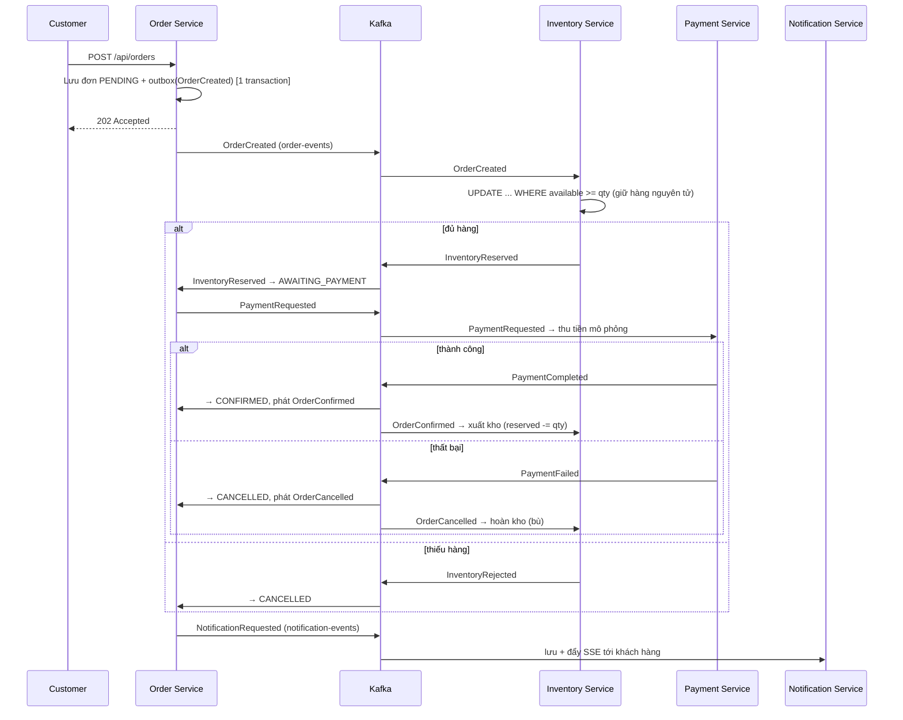

# Kiến trúc hệ thống

## 1. Nguyên tắc

- **Mỗi service một miền nghiệp vụ, một database riêng** (`auth_db`, `order_db`, ...). Không service nào đọc bảng của service khác.
- **REST** cho yêu cầu cần phản hồi ngay (xem sản phẩm, tạo đơn, quản trị). **Kafka** cho mọi tương tác giữa các service.
- Service khác cần dữ liệu sản phẩm (giá, tên) thì **tự duy trì read-model** từ `product-events` (Order: `product_snapshots`, Cart: `catalog_items`, Inventory: `inventories`) → không có lời gọi đồng bộ giữa các service, một service chết không kéo theo service khác.
- **API Gateway** là điểm vào duy nhất: xác thực JWT, gắn `X-User-Id / X-User-Email / X-User-Roles` cho service phía sau và **xóa các header này nếu client tự gửi** (chống giả mạo). Service vẫn kiểm tra quyền chi tiết (phòng thủ 2 lớp).

## 2. Kafka topics

| Topic | Producer | Consumer | Sự kiện |
|---|---|---|---|
| `user-events` | auth | user, analytics | UserRegistered, UserLoggedIn, UserRolesChanged |
| `product-events` | product | order, cart, inventory | ProductCreated, ProductUpdated, ProductDiscontinued |
| `cart-events` | cart | analytics | CartItemAdded, CartItemUpdated, CartItemRemoved, CartCleared |
| `order-events` | order | inventory, payment, cart, analytics | OrderCreated, PaymentRequested, OrderConfirmed, OrderCancelled, OrderStatusChanged |
| `inventory-events` | inventory | order, analytics | InventoryReserved, InventoryRejected, InventoryCommitted, InventoryReleased, StockUpdated, StockLow |
| `payment-events` | payment | order, analytics | PaymentCompleted, PaymentFailed, PaymentRefunded |
| `notification-events` | order, inventory, payment | notification | NotificationRequested |
| `analytics-events` | Kafka Streams (analytics) | analytics (dashboard) | MetricUpdated, AlertRaised |
| `<topic>-dlt` | Spring Kafka error handler | (vận hành) | Message lỗi sau khi hết số lần retry |

Mỗi topic nghiệp vụ có 3 partition; **key = aggregateId** (orderId, productId, userId) nên mọi sự kiện của cùng một đơn hàng nằm trên cùng partition và được xử lý **đúng thứ tự**. Mỗi listener là một consumer group riêng (`order-service.payment-events`, `inventory-service.order-events`, ...) với `concurrency = 3` = số partition (TC10).

### Event schema (envelope)

```json
{
  "eventId": "5b0e0f2e-8d1f-4a3e-9c55-0e7a1f0c2a11",
  "eventType": "OrderCreated",
  "version": 1,
  "occurredAt": "2026-11-19T03:15:22.481Z",
  "source": "order-service",
  "aggregateId": "1024",
  "payload": { "orderId": 1024, "userId": 7, "items": [ ... ], "totalAmount": 3700000, "paymentMethod": "MOCK_CARD" }
}
```

Định nghĩa trong [`libs/common`](../libs/common/src/main/java/com/shop/common/event). `version` cho phép tiến hóa schema (có thể thay bằng Schema Registry ở giai đoạn sau).

## 3. Luồng đặt hàng – Saga (orchestration bởi Order Service)



Máy trạng thái đơn hàng ([`OrderStatus`](../services/order-service/src/main/java/com/shop/order/domain/OrderStatus.java)):

```
PENDING → AWAITING_PAYMENT → CONFIRMED → SHIPPING → DELIVERED
   └──────────┴─────────────────┴──→ CANCELLED
```

**Timeout & bù:** `OrderTimeoutJob` quét định kỳ, đơn kẹt ở `PENDING/AWAITING_PAYMENT` quá `ORDER_TIMEOUT` (mặc định 2 phút) bị hủy → `OrderCancelled` → Inventory hoàn kho, Payment **tự hoàn tiền** nếu đã thu (kể cả khi kết quả thanh toán đến muộn). Khách/admin hủy đơn đã xác nhận cũng đi qua cùng cơ chế.

## 4. Độ tin cậy

| Cơ chế | Hiện thực |
|---|---|
| **Transactional Outbox** | [`OutboxService`](../libs/service-support/src/main/java/com/shop/support/outbox/OutboxService.java) ghi sự kiện vào bảng `outbox_events` trong cùng transaction với dữ liệu nghiệp vụ; [`OutboxRelay`](../libs/service-support/src/main/java/com/shop/support/outbox/OutboxRelay.java) publish theo thứ tự, dừng ở lỗi đầu tiên và thử lại. Không còn trường hợp "DB đã commit nhưng sự kiện mất". |
| **Idempotent consumer** | [`IdempotencyGuard`](../libs/service-support/src/main/java/com/shop/support/outbox/IdempotencyGuard.java): `INSERT INTO processed_events ... ON CONFLICT DO NOTHING` trong cùng transaction với xử lý → sự kiện gửi lại (at-least-once) không gây tác động trùng (TC09). Thêm ràng buộc nghiệp vụ: mỗi đơn chỉ một payment, reservation unique theo (order, product). |
| **Retry + backoff** | `DefaultErrorHandler` với exponential backoff (500ms × 2, 3 lần). |
| **Dead Letter Topic** | Hết retry → message sang `<topic>-dlt`. Message sai định dạng (`MalformedEventException`) vào DLT ngay, không chặn partition (TC07). |
| **Chống bán vượt** | Giữ hàng bằng `UPDATE inventories SET available = available - :q ... WHERE available >= :q`; nhiều dòng được khóa theo thứ tự productId để tránh deadlock. |
| **Phục hồi** | Consumer commit offset sau khi xử lý xong; dừng/khởi động lại service sẽ tiếp tục từ offset cuối (TC06). Kafka Streams thread lỗi được thay thế (`REPLACE_THREAD`). |

## 5. Analytics – Kafka Streams

Topology: [`AnalyticsTopology`](../services/analytics-service/src/main/java/com/shop/analytics/streams/AnalyticsTopology.java)

| Chỉ số | Nguồn | Kỹ thuật |
|---|---|---|
| Doanh thu 1 phút / 5 phút / 1 giờ | payment-events (Completed − Refunded) | Tumbling window + aggregate |
| Tổng doanh thu, số giao dịch | payment-events | KTable aggregate |
| Đơn mới / phút + **cảnh báo đột biến** | order-events | Windowed count, alert khi vượt ngưỡng (1 lần/cửa sổ) |
| Thanh toán lỗi / phút + cảnh báo | payment-events | Windowed count |
| Đơn theo trạng thái | order-events | `toTable` (trạng thái mới nhất mỗi đơn) → `groupBy(status).count()` (tự trừ trạng thái cũ) |
| Top sản phẩm bán chạy | OrderConfirmed (trừ lại nếu hủy sau xác nhận) | flatMap item → aggregate theo productId |
| Người dùng hoạt động 5 phút | user/cart/order events | Hopping window 5m/1m, tập userId duy nhất |
| Phễu: thêm giỏ → tạo đơn → thanh toán → xác nhận | mọi topic | Bộ đếm KTable |
| Tồn kho thấp | inventory-events | StockUpdated / StockLow → alert |
| Hiệu suất Kafka | AdminClient | Consumer lag theo group, msg/s theo topic ([`KafkaMonitor`](../services/analytics-service/src/main/java/com/shop/analytics/monitor/KafkaMonitor.java)) |

Kết quả ghi lên `analytics-events` → `AnalyticsEventsConsumer` cập nhật trạng thái Dashboard trong bộ nhớ + upsert vào bảng tổng hợp (`sales_aggregates`, `product_statistics`, `event_statistics`, `analytics_alerts`). Dashboard **không bao giờ truy vấn bảng nghiệp vụ**. Trình duyệt nhận snapshot qua SSE tối đa 1 lần/giây (throttle) và cảnh báo ngay lập tức.

## 6. Bảo mật

- Mật khẩu băm BCrypt; JWT HS256 (`JWT_SECRET` dùng chung Auth ↔ Gateway, cấu hình qua biến môi trường).
- SSE dùng `?access_token=` vì `EventSource` không gửi được header; Gateway chấp nhận cả hai cách.
- Gateway: route công khai (đăng nhập, đăng ký, xem sản phẩm/danh mục, tồn kho khả dụng); `/api/analytics/**` chỉ cho nhân viên; `/api/auth/users/**` chỉ ADMIN.
